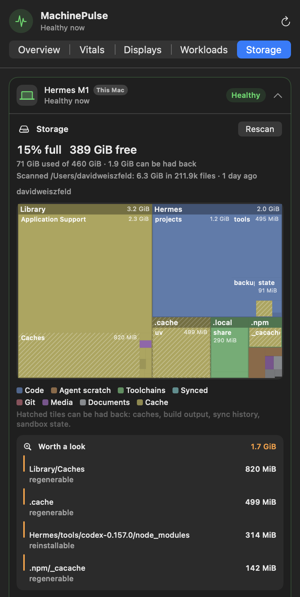

# MachinePulse


MachinePulse is a macOS menu-bar monitor for your Mac and the machines on your tailnet. It also shows the Claude Code and Codex sessions that run on these machines. It shows first the incident that needs your attention. It keeps the evidence of short problems. It never changes anything on a remote machine.

MachinePulse reads data from systems that you already trust:

- Tailscale tells which machines are on the tailnet and which are reachable.
- OpenSSH connects to a Linux machine or to another Mac.
- The kernel and the system tools on each machine give the readings.

MachinePulse has no account, no server, and no monitoring agent. You install nothing on the other machines, and all data stays on your Mac. To see Claude Code and Codex sessions, you can add a small plugin to the coding agent. See [Agent sessions](#agent-sessions).

## Install

There is no prebuilt app. Build it on your Mac:

```sh
git clone https://github.com/weiszfelddavid/machinepulse
cd machinepulse
./scripts/install-app.sh      # installs ~/Applications/MachinePulse.app, ad-hoc signed
./scripts/uninstall-app.sh    # removes the app and its login item; --purge also removes data
```

You need:

- macOS 15 or later, and Swift 6.2 or later from Xcode. On macOS 15 and 26, the Command Line Tools also work. On macOS 27, they do not have the SwiftUI macro plugin, so use Xcode.
- Tailscale, connected, to see the other machines. Without Tailscale, MachinePulse monitors this Mac only.
- For full metrics on a remote machine: Python 3 on that machine, and an SSH key that works without a prompt. Another Mac also needs Remote Login and the Command Line Tools.

## Use

1. Open MachinePulse from the menu bar.
2. Enable a machine that MachinePulse found.
3. Choose **Presence** or **Full metrics**.
4. For a Linux machine or another Mac, confirm the SSH alias that MachinePulse found in `~/.ssh/config`, or type a target such as `user@host`.

Only enabled machines change the health in the menu bar.

The panel shows the same machine cards in five sections:

- **Overview** — the health now, the active or recent incident, the current readings, and links to the other sections.
- **Vitals** — a 15-minute chart, the processes that use the most, and up to 90 days of hourly capacity history.
- **Displays** — optional XDR Boost for the compatible displays of this Mac. It is off by default.
- **Workloads** — the Claude Code and Codex sessions on each machine with the agents plugin, the project servers that listen on this Mac, and the systemd services, listeners, and cgroup limits of a Linux machine.
- **Storage** — press **Scan** to see a treemap of the disk space. The space that you can get back is hatched, and the **Worth a look** list shows what to check.

<p>


</p>

A warning needs two samples that agree. A critical reading shows at once. Recovery waits for clear samples. Linux pressure waits for two quiet minutes, so a short recurrence stays one incident. **Unreachable** means that Tailscale reports the machine offline. A collection problem on an online machine is a different warning, and the last good sample stays on screen. Phones and tablets that go offline do not raise an alert.

## Agent sessions

Install the `machinepulse-agents` plugin on each machine where you run Claude Code or Codex. Include this Mac.

```sh
claude plugin marketplace add weiszfelddavid/machinepulse
claude plugin install machinepulse-agents@machinepulse

codex plugin marketplace add weiszfelddavid/machinepulse
codex plugin add machinepulse-agents@machinepulse
```

Codex runs the hooks of a plugin only after you trust them. The next time that you start `codex`, it shows **Hooks need review**. Choose **Review hooks** or **Trust all and continue**. Until you do this, MachinePulse does not see your Codex sessions. Codex asks again when an update changes the hooks.

The plugin is one POSIX `sh` hook. It writes one small file for each interactive session to `~/.local/state/machinepulse/agents/`. MachinePulse reads these files every ten seconds. It must monitor the machine with **Full metrics**.

- **Workloads** lists each session with its project and its state: working, needs approval, finished, or idle.
- A bubble rises from the bottom center of each display when a task of 30 seconds or more finishes. It also rises when a session needs approval. Its colors are the opposite of the system appearance. It grows one step each minute for ten minutes while the agent waits. It stays until you open the session, press ×, or the agent works again. Hover over it to see the folder, the task length, and the other sessions that wait. You can turn it off in Settings.
- A click on the bubble or on the row opens the terminal of the session:
  - On this Mac, MachinePulse selects the Terminal or iTerm2 tab of the session. It brings any other terminal app to the front.
  - On another machine, MachinePulse finds the `ssh` connection from this Mac that the session runs in, and selects its tab. If that connection is gone, for example after a reattach to tmux, MachinePulse uses the only `ssh` tab to that machine.
  - In [herdr](https://herdr.dev) on this Mac, MachinePulse shows the pane of the session and brings the herdr window to the front.
  - In herdr on another machine, MachinePulse brings the `ssh` tab or the `herdr --remote` window to the front. It does not change the pane on that machine.
- macOS asks one time for each terminal app (Automation).

Limits:

- A session without a terminal, such as `claude -p` or `codex exec`, is not listed.
- If the original connection is gone and several `ssh` tabs go to the machine, MachinePulse cannot know the tab. The bubble tells you why.
- With OpenSSH `ControlMaster`, all sessions to one host share one connection. MachinePulse can only find the tab that opened that connection.
- Termius and other apps with their own SSH client start no `ssh` process, so MachinePulse cannot find their tab.

## What it measures

- CPU, load, memory, swap, disk capacity, and disk and network throughput
- Linux CPU, memory, and I/O pressure, with "some tasks waited" and "all tasks waited" kept apart
- Top processes, failed services, new out-of-memory kills, and an optional watchlist of expected systemd units
- cgroup-v2 limits and throttling for the services and agents that matter, judged by their effect, not by their configuration
- Disk composition when you ask: allocated size, each hardlink counted once, symlinks not followed, and cloud-only folders never opened. The kinds and the reasons to reclaim come from [disktree](https://github.com/tobi/disktree).

MachinePulse keeps detailed samples for one day, hourly capacity summaries for 90 days, and incidents for 30 days. They are all in one SQLite file under `~/Library/Application Support/MachinePulse`.

## What it refuses to do

- Run anything persistent on a remote machine. MachinePulse streams the collector to `sh` over SSH. The collector returns one JSON document and exits.
- Read environments, file contents, or credentials. The one exception is the state files that the agents plugin writes for MachinePulse.
- Read command lines on a remote machine. On this Mac, it reads them only to identify project servers and herdr windows.
- Delete, trash, stop, or restart anything on a remote machine. The only action that changes something is a confirmed, graceful stop of a project server that you own on this Mac.
- Ask for Screen Recording, Accessibility, or Input Monitoring. XDR Boost draws a uniform overlay and never reads pixels. MachinePulse asks for Automation only when you open an agent session, to select its tab in Terminal or iTerm2.
- Send telemetry. MachinePulse copies a diagnostic to the pasteboard only when you ask. The diagnostic tells you what it contains before you share it.

## Develop

```sh
./scripts/verify.sh                        # build, verifier, formatter, collector syntax
swift build -Xswiftc -warnings-as-errors
swift test
```

[AGENTS.md](AGENTS.md) is the working contract: commands, house rules, invariants, and where changes belong. [docs/](docs) has notes on the [product behavior](docs/PRODUCT.md), the [architecture](docs/ARCHITECTURE.md), the [security boundary](docs/SECURITY.md), and [development](docs/DEVELOPMENT.md). [CHANGELOG.md](CHANGELOG.md) lists what each version added.

Use the [issue forms](https://github.com/weiszfelddavid/machinepulse/issues/new/choose) for bugs and ideas. Read a copied diagnostic before you attach it: it names devices, addresses, processes, and services. Send security problems through [private vulnerability reporting](https://github.com/weiszfelddavid/machinepulse/security/advisories/new).

## License

MIT. The third-party notices are in [THIRD-PARTY-NOTICES.md](THIRD-PARTY-NOTICES.md).

Made by [@weiszfeld](https://x.com/weiszfeld).
